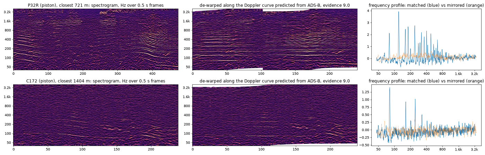

# doppler-geo

Find where an audio recording was made, anywhere on Earth, from the propeller aircraft that can be heard in it.

Light aircraft broadcast their positions over ADS-B, and their engines and propellers hum at a steady pitch. A microphone hears that hum Doppler-shifted along a curve fixed entirely by geometry: where the aircraft was relative to the microphone at each moment. `doppler-locate` takes a recording, its start time and a day of global ADS-B history, and searches the whole planet for the point where the Doppler curves predicted for passing aircraft line up with the spectrogram.



*Two passes from the benchmark. Left: the spectrogram around the pass. Middle: the same spectrogram shifted so that the Doppler curve predicted from the aircraft's ADS-B track at the camera's location becomes flat, which turns the engine harmonics into straight lines. Right: averaged over the pass, the matched profile (blue) shows the harmonic comb; the control along the mirrored Doppler curve (orange) does not.*

## Results

The benchmark uses 58 public YouTube railway webcams with published locations ([`sites.json`](sites.json)). Each contributes about 9 hours of audio from 9 November 2026, searched against the [adsb.lol](https://adsb.lol) global archive for that day with no prior on location. 31 of the 58 have been evaluated so far:

| Error of the top answer | Cameras |
|---|---|
| under 100 m | 11 |
| under 1 km (worst 438 m) | 20 |
| wrong, 580 to 5,000 km away | 11 |

Every answer whose significance beat the runner-up candidate by more than 5 (in −log10 p) was correct: 15 of 15, with a median error of 72 m. Every wrong answer beat the runner-up by less than 3. That threshold was chosen after looking at these same results, so treat it as a rule of thumb until the remaining sites confirm it.

A run takes about 2 minutes on 16 threads for a 9-hour recording, including streaming the 3.7 GB daily archive.

The limiting factor is audio, not compute. A confident fix needs roughly four well-heard passes of propeller aircraft. At the benchmark cameras, the estimated share that reaches one is about 4% after 30 minutes of audio, 9% after an hour, 20% after 2 hours and 40% after 4 hours. About a third of the cameras never get there, because their airspace is quiet or carries only jets. [`research/`](research) has the measurements behind these numbers.

## How it works

1. **Spectrogram.** 2.048 s Hann windows every 0.5 s are resampled onto a log-frequency grid (0.5% steps, 40 Hz to 4 kHz). Slow level changes and stationary lines are removed, and each bin is normalized robustly.
2. **Tracks.** Propeller aircraft and helicopters (by ICAO type) that come below 5 km altitude are read from the archive and resampled every 0.5 s.
3. **Pass score.** For a candidate point and clock offset, each nearby track predicts when its sound arrives (range / speed of sound) and its Doppler factor c / (c + ṙ). Spectrogram rows are shifted by the log of that factor and averaged, weighted by (r_min / r)². The score is the robust peak height of the averaged profile minus the same quantity along the mirrored Doppler curve.
4. **Significance.** Each pass score becomes a p-value against an empirical null: the same scores at cells all over the world, with an exponential tail fit. Passes are combined with Fisher's method, and the clock offset is searched over ±30 s in 2 s steps.
5. **Search.**
   - A 500 m grid covers every area any track passes through, scored with a bank of precomputed straight-pass templates.
   - The best 3,000 cells are re-scored exactly.
   - The 20 best candidates at least 3 km apart are refined on 100 m and then 25 m grids, using terrain heights from Terrarium elevation tiles.

## Usage

You need Rust (edition 2024), `ffmpeg`, and `gh` to download the archive.

```sh
cargo build --release

mkdir -p ext
curl -L https://raw.githubusercontent.com/wiedehopf/tar1090-db/master/db/icao_aircraft_types.js -o ext/types.js

gh release download v2026.11.09-planes-readsb-prod-0 -R adsblol/globe_history_2026 -D archive

ffmpeg -i recording.m4a -ac 1 -ar 16000 -c:a pcm_s16le recording.wav
echo 1794231131.449 > recording.wav.start

target/release/doppler-locate --audio recording.wav --archive archive/v2026.11.09-planes-readsb-prod-0.tar.* --types ext/types.js --out located.json
```

- **Recording.** A mono 16-bit WAV. Next to it, `<name>.wav.start` holds the UTC Unix time of the first sample, accurate to within ±30 s.
- **Archive.** The [adsb.lol](https://github.com/adsblol) daily releases cover the whole world, one repository per year, and are published the following day. `--adsb` takes JSON-lines snapshots from the adsb.lol or adsb.fi point APIs instead (see `tools/poll_adsb.py`).
- **Terrain.** Tiles are downloaded on first use into `dem/` (`--dem` changes the location).

`located.json` lists the five finalists, best first:

| Field | Meaning |
|---|---|
| `lat`, `lon` | location |
| `significance` | −log10 p of all passes combined |
| `offset_s` | how far the recording's timestamps run ahead of ADS-B time |
| `passes` | aircraft passes that contributed |
| `scan_rank`, `scan_significance`, `screen_significance` | where the candidate stood at the earlier search stages |

`doppler-extract` pulls every aircraft within a radius of each site from the archive into per-site JSON files, in the format the research scripts read.

## Reproducing the benchmark

```sh
pip install -r requirements.txt
mkdir -p dvr
yt-dlp --flat-playlist --print '%(id)s|%(live_status)s|%(title)s' https://www.youtube.com/@VirtualRailfan/streams > dvr/streams.txt
python tools/locate_cams.py
python tools/grab_youtube.py dvr/streams.txt 0 1
python tools/make_sites.py
python tools/eval_sites.py archive/v2026.11.09-planes-readsb-prod-0.tar.aa,archive/v2026.11.09-planes-readsb-prod-0.tar.ab eval target/release/doppler-locate
```

1. `locate_cams.py` reads each stream's "Camera Location:" link and saves the coordinates to `dvr/cams.json`.
2. `grab_youtube.py` saves the last ~9 hours of each live stream's DVR window as `dvr/<video>_<start>.opus`. Its arguments are the shard index and shard count.
3. `make_sites.py` builds `sites.json`.
4. `eval_sites.py` locates every site and prints the error, the significance and the runner-up.

If YouTube asks for sign-in, `locate_cams.py` and `grab_youtube.py` take a browser name as their last argument (for example `firefox`), which yt-dlp uses for cookies. The audio itself is not redistributed. The streams' DVR windows have expired, so the benchmark has to be rebuilt with new recordings and the matching archive day.

## Limitations

- **Aircraft.** Only propeller aircraft and helicopters count; jets are inaudible beyond about 4 km in this data. Audibility depends on elevation angle more than distance: passes more than 15° above the horizon give most detections, and beyond 7 km the tone is gone even with its frequency known in advance.
- **Few passes.** One straight pass fits many points: its mirror image across the track, and points along the track when the clock offset is free. Worldwide, dozens of other aircraft fly the same speed at the same moment. The coarse search also assumes straight passes. In a synthetic test with two passes, it settled on a wrong candidate even though the true point scored higher; with four passes it finds the point within 35 m.
- **Coverage.** Aircraft without ADS-B, or outside receiver coverage, are invisible.

## Layout

| Path | Contents |
|---|---|
| `src/` | the locator (`doppler-locate`) and the track extractor (`doppler-extract`) |
| `tests/` | end-to-end test: synthesizes four Doppler-shifted propeller passes, silent background traffic and flat terrain, runs the binary, expects an error under 100 m |
| `tools/` | recording, ground truth and benchmark scripts |
| `research/` | Python experiments behind the design, with findings |

## License

The code is released under the [MIT license](LICENSE). The data it uses carries its own terms:

- ADS-B history: [adsb.lol](https://github.com/adsblol/globe_history_2026), Open Database License.
- Aircraft types: [tar1090-db](https://github.com/wiedehopf/tar1090-db).
- Terrain: [Terrarium tiles](https://registry.opendata.aws/terrain-tiles/) on AWS Open Data.
